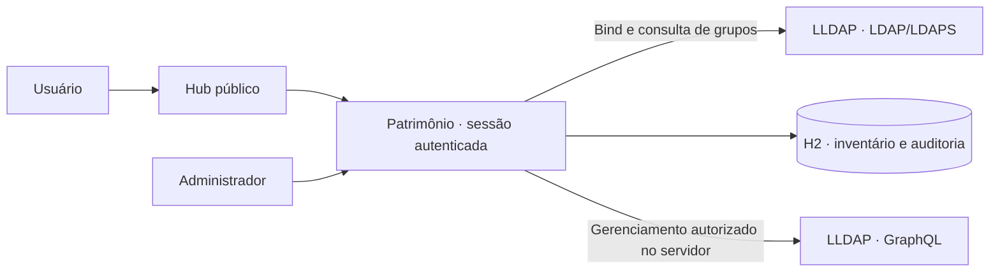

# Serviços IEEE IFF Campos Centro

Documentação de arquitetura, acesso e operação do Hub e do inventário físico.

| Repositório | Responsabilidade |
| --- | --- |
| [ieee-iff-hub](https://github.com/rafaelfrancapc/ieee-iff-hub) | Catálogo público de serviços, orientações de acesso e diretorias |
| [ieee-iff-patrimonio](https://github.com/rafaelfrancapc/ieee-iff-patrimonio) | Inventário físico, login LDAP, sigilo e administração de contas |
| [ieee-iff-docs](https://github.com/rafaelfrancapc/ieee-iff-docs) | Documentação geral e exemplo de implantação conjunta |

## Guias

- [Arquitetura](docs/ARQUITETURA.md)
- [Papéis e sigilo](docs/ACESSOS-E-SIGILO.md)
- [Implantação com LLDAP](docs/IMPLANTACAO.md)
- [Operação, backup e recuperação](docs/OPERACAO.md)
- [Verificação e limites dos testes](docs/VERIFICACAO.md)
- [Tratamento de informações sensíveis](SECURITY.md)

Os repositórios contêm código, documentação e exemplos fictícios. Credenciais, dados reais do inventário e configurações privadas devem permanecer no ambiente de implantação. Publicar o código não publica o banco nem configura serviços ou DNS.
